# Земля с орбиты

Трёхмерная Земля прямо в браузере на WebGL2: физически корректная атмосфера, объёмные облака, смена дня и ночи, огни городов, полярные сияния, Луна и звёзды. Летать можно от «голубого шарика» за 13 000 км до стратосферы и над облаками.

**▶ Открыть:** https://fedor655.github.io/earth-from-orbit/
Старая версия, без объёмных облаков и полегче для слабых компьютеров: https://fedor655.github.io/earth-from-orbit/v3/

Ничего не нужно устанавливать. Каждая версия — это один HTML-файл, все текстуры внутри. Его можно скачать и открыть без интернета (без сети только шрифты будут системные).

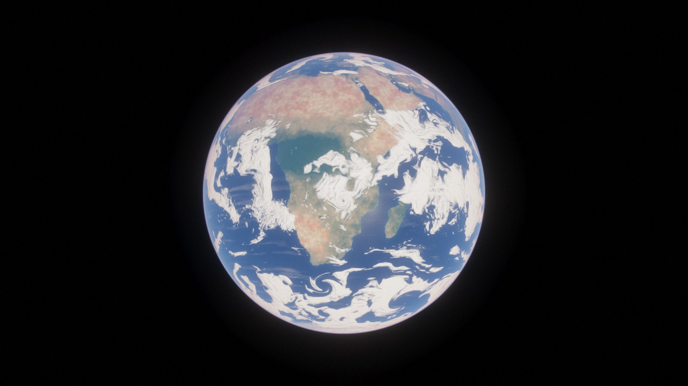

## Ракурсы

| | |
|---|---|
| 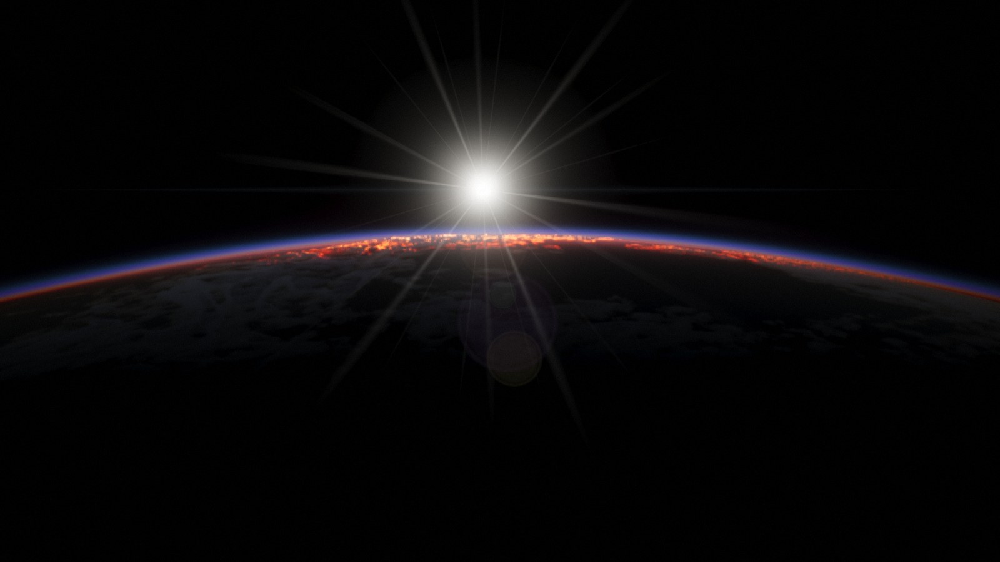 **Рассвет на орбите** | 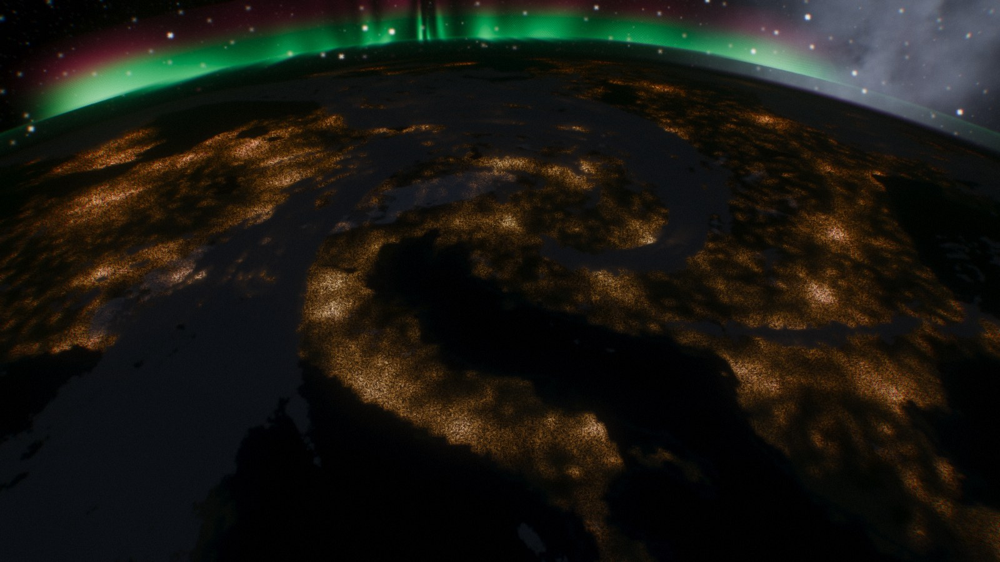 **Европа ночью** |
| 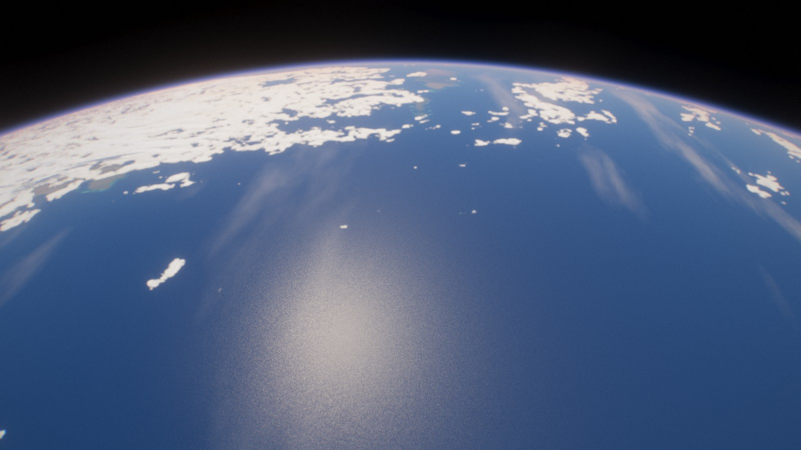 **Солнечный блик** | 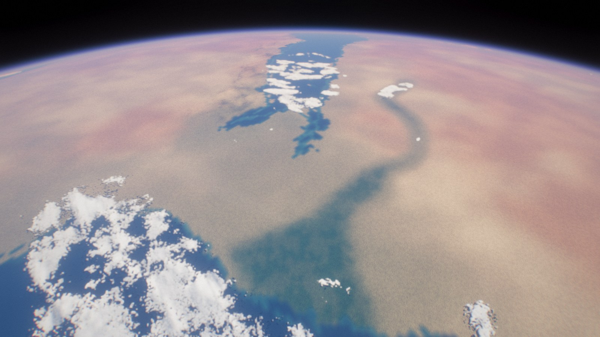 **Нил и Синай** |
| 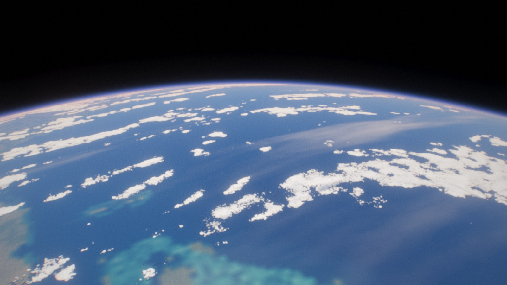 **Багамы** | 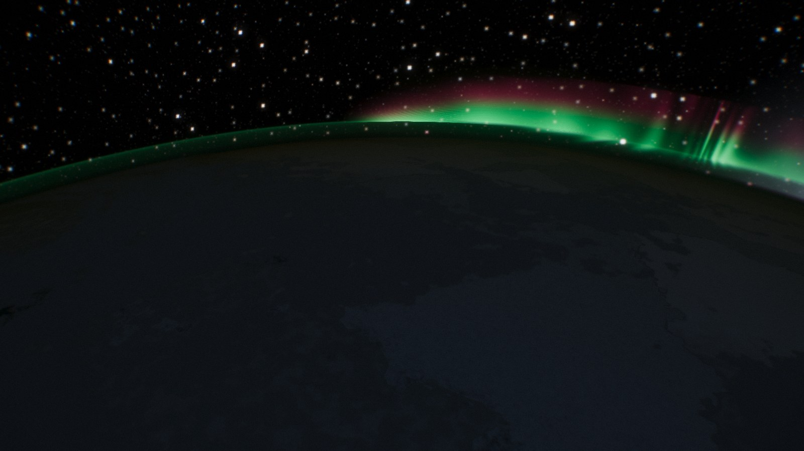 **Северное сияние** |
| 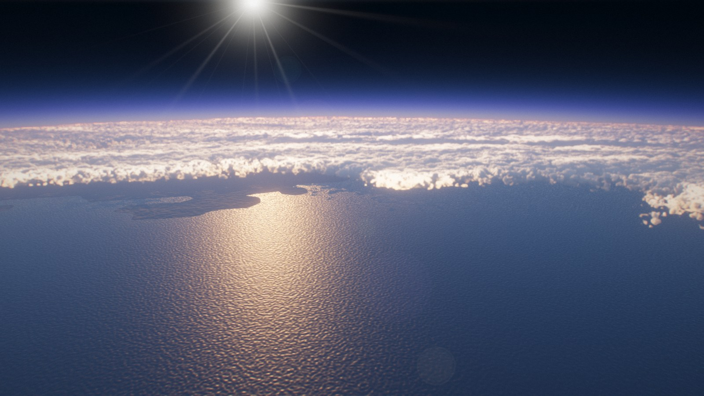 **Стратосфера** | 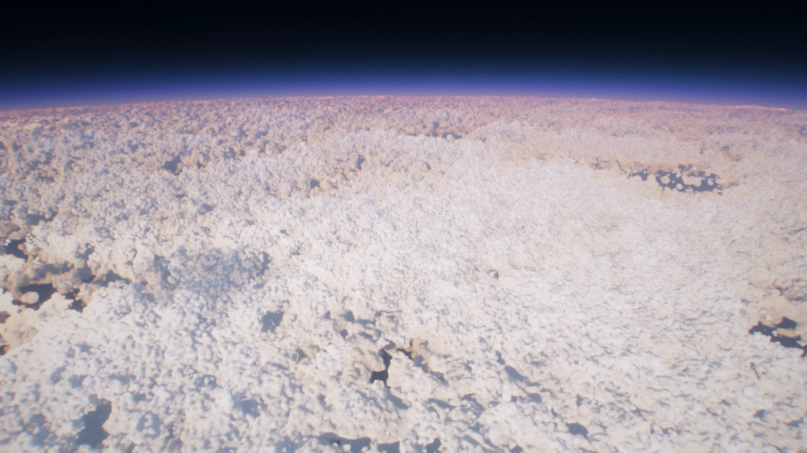 **Грозовые башни** |
| 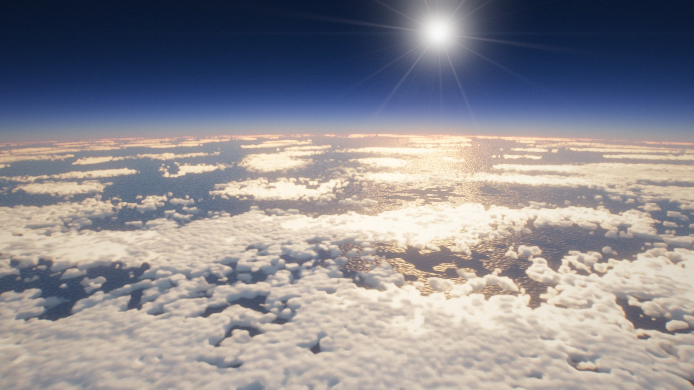 **Над облаками** | 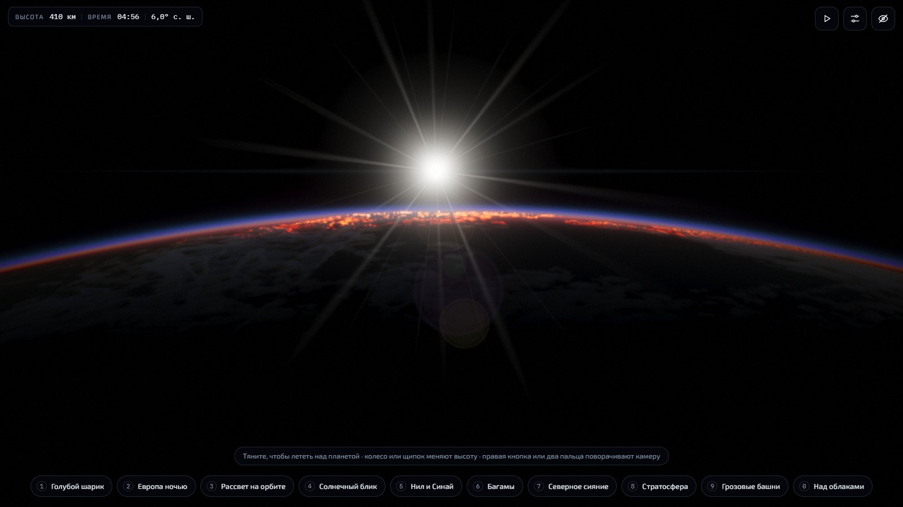 **С интерфейсом** |

## Управление

- **Мышь:** тянуть — лететь над планетой, колесо — высота, правая кнопка — поворот камеры.
- **Телефон:** один палец — полёт, щипок — высота, два пальца — поворот.
- **Клавиатура:** WASD — полёт, Q/E — поворот, R/F — наклон, + и − — высота, 1–9 и 0 — готовые ракурсы, C — кино-режим (автоматический облёт), H — скрыть интерфейс, «,» и «.» — скорость времени.

В настройках можно менять качество, время суток и сезон, экспозицию, включать и выключать облака, атмосферу, огни городов, сияния, Луну, звёзды, молнии, свечение, блики и зерно. Ещё там можно сгенерировать выдуманную планету.

## Две версии

| | Новая (v4) | Старая (v3) |
|---|---|---|
| Облака | объёмные, с тенями и грозовыми башнями | плоский слой |
| Нагрузка | нужна нормальная видеокарта | идёт и на слабом железе |
| Файл | [`index.html`](index.html) | [`v3/index.html`](v3/index.html) |

Старая версия:

| | |
|---|---|
| 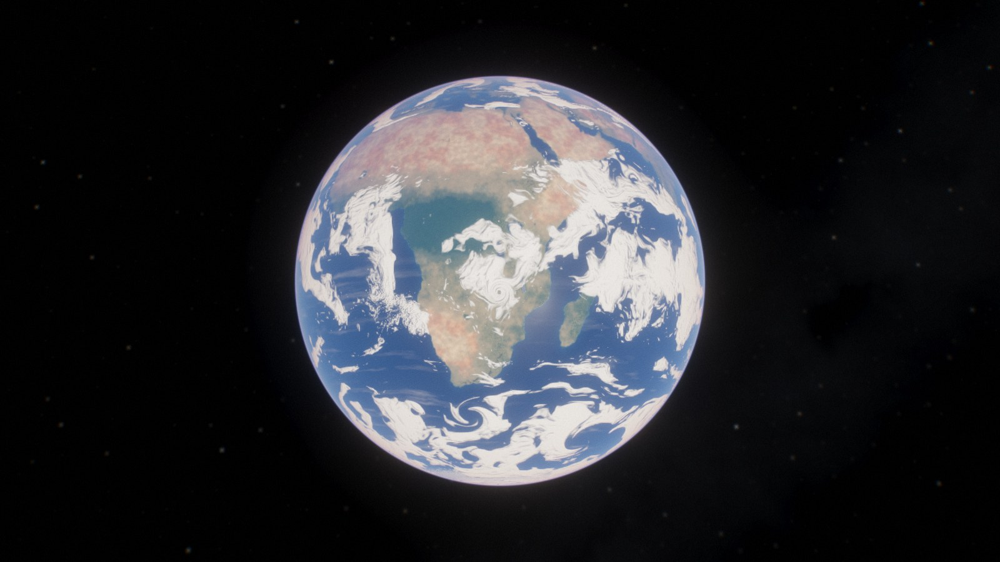 | 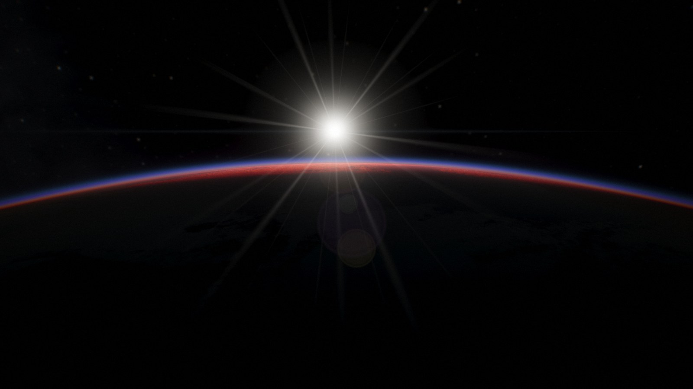 |
| 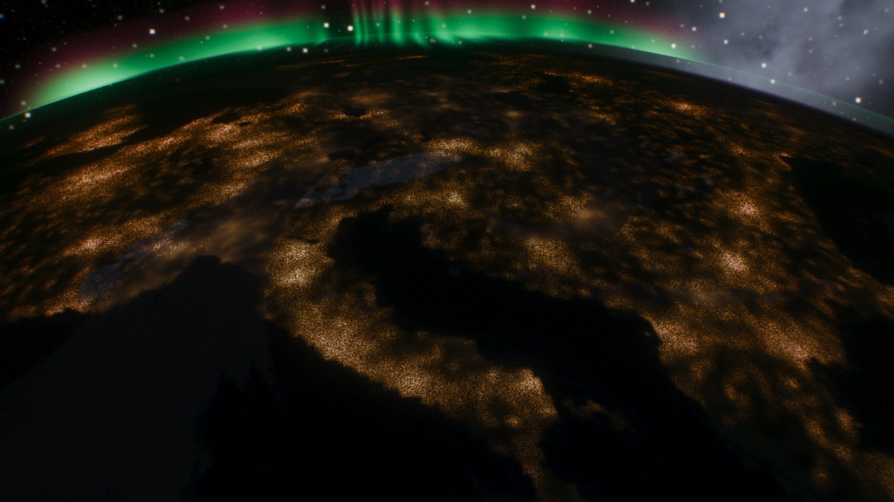 |  |

## Требования

Браузер с WebGL2: свежий Chrome, Edge, Firefox или Safari, на компьютере или телефоне. Если тормозит, в настройках поставьте качество «Среднее» и уменьшите разрешение рендера, либо откройте старую версию.
